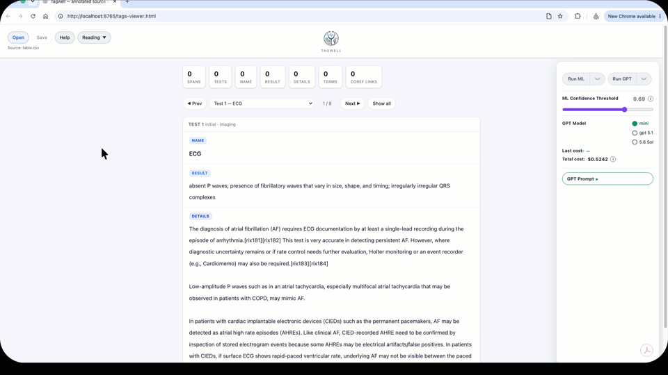

### Tagwell — AI-assisted clinical tagging

Finds and labels clinical tests and investigations in medical text: three fine-tuned biomedical
transformers, a learned stacker and a labeller, with a GPT arm alongside. Built during S2DS Summer
2026 in a project with BMJ.

